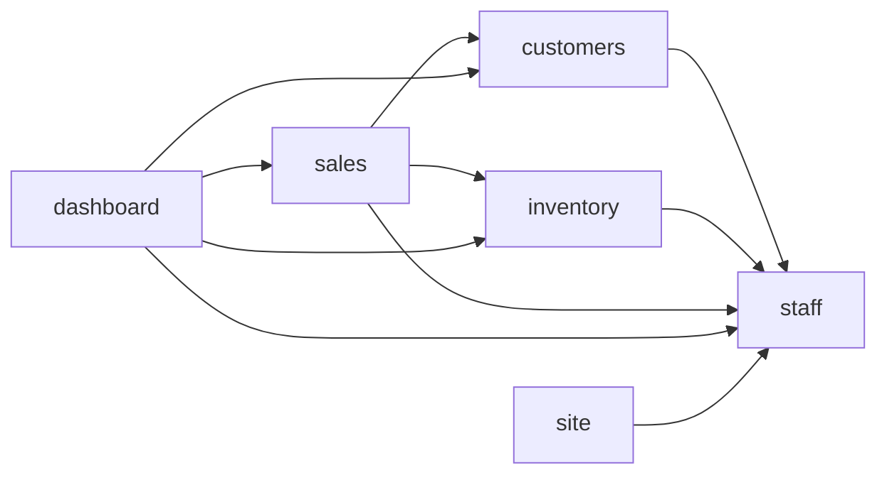

# Code wiki

Generated by `composer run build` from the module manifests, `build/surface.json` and the code index; an edit here fails gate:24. How AIC works: [the architecture pages](../../vendor/aic/framework/docs/README.md).

## Modules

| Module | Namespace | Requires | Required by | Routes | Classes |
| --- | --- | --- | --- | --- | --- |
| [staff](modules/staff.md) | `App\Staff\` | none | customers, inventory, sales, dashboard, site | Page 3 | 21 |
| [customers](modules/customers.md) | `App\Customers\` | staff | sales, dashboard | Page 8 | 34 |
| [inventory](modules/inventory.md) | `App\Inventory\` | staff | sales, dashboard | Page 8 | 40 |
| [sales](modules/sales.md) | `App\Sales\` | inventory, customers, staff | dashboard | Page 6 | 40 |
| [dashboard](modules/dashboard.md) | `App\Dashboard\` | customers, inventory, sales, staff | none | Page 1, Stream 1 | 14 |
| [site](modules/site.md) | `App\Site\` | staff | none | Api 1, Page 3 | 18 |

## Theme

Every component, layout and asset lives in `themes/lotline/` (#153). The page `themes/lotline/layouts/page.phtml` reads `App\Theme\Layouts\Page`, whose regions are sidebar, header, content, footer; the document is `themes/lotline/layouts/html.phtml`.

| Component | Template |
| --- | --- |
| `App\Theme\Components\BarChart\BarChart` | `themes/lotline/components/BarChart/bar-chart.phtml` |
| `App\Theme\Components\BootstrapIntro\BootstrapIntro` | `themes/lotline/components/BootstrapIntro/bootstrap-intro.phtml` |
| `App\Theme\Components\ColumnChart\ColumnChart` | `themes/lotline/components/ColumnChart/column-chart.phtml` |
| `App\Theme\Components\ConfirmCard\ConfirmCard` | `themes/lotline/components/ConfirmCard/confirm-card.phtml` |
| `App\Theme\Components\DataTable\DataTable` | `themes/lotline/components/DataTable/data-table.phtml` |
| `App\Theme\Components\DetailCard\DetailCard` | `themes/lotline/components/DetailCard/detail-card.phtml` |
| `App\Theme\Components\FilterBar\FilterBar` | `themes/lotline/components/FilterBar/filter-bar.phtml` |
| `App\Theme\Components\FormActions\FormActions` | `themes/lotline/components/FormActions/form-actions.phtml` |
| `App\Theme\Components\FormField\FormField` | `themes/lotline/components/FormField/form-field.phtml` |
| `App\Theme\Components\FormGrid\FormGrid` | `themes/lotline/components/FormGrid/form-grid.phtml` |
| `App\Theme\Components\FormValue\FormValue` | `themes/lotline/components/FormValue/form-value.phtml` |
| `App\Theme\Components\Icon\Icon` | `themes/lotline/components/Icon/icon.phtml` |
| `App\Theme\Components\IconEntry\IconEntry` | `themes/lotline/components/IconEntry/icon-entry.phtml` |
| `App\Theme\Components\IconLegend\IconLegend` | `themes/lotline/components/IconLegend/icon-legend.phtml` |
| `App\Theme\Components\LiveParts\LiveParts` | `themes/lotline/components/LiveParts/live-parts.phtml` |
| `App\Theme\Components\NavLink\NavLink` | `themes/lotline/components/NavLink/nav-link.phtml` |
| `App\Theme\Components\Navigation\Navigation` | `themes/lotline/components/Navigation/navigation.phtml` |
| `App\Theme\Components\Notice\Notice` | `themes/lotline/components/Notice/notice.phtml` |
| `App\Theme\Components\Pagination\Pagination` | `themes/lotline/components/Pagination/pagination.phtml` |
| `App\Theme\Components\Panel\Panel` | `themes/lotline/components/Panel/panel.phtml` |
| `App\Theme\Components\PanelGrid\PanelGrid` | `themes/lotline/components/PanelGrid/panel-grid.phtml` |
| `App\Theme\Components\SelectField\SelectField` | `themes/lotline/components/SelectField/select-field.phtml` |
| `App\Theme\Components\SignedInMenu\SignedInMenu` | `themes/lotline/components/SignedInMenu/signed-in-menu.phtml` |
| `App\Theme\Components\SiteFooter\SiteFooter` | `themes/lotline/components/SiteFooter/site-footer.phtml` |
| `App\Theme\Components\StatTiles\StatTiles` | `themes/lotline/components/StatTiles/stat-tiles.phtml` |
| `App\Theme\Components\StatusBadge\StatusBadge` | `themes/lotline/components/StatusBadge/status-badge.phtml` |
| `App\Theme\Components\TableResults\TableResults` | `themes/lotline/components/TableResults/table-results.phtml` |
| `App\Theme\Components\TableRow\TableRow` | `themes/lotline/components/TableRow/table-row.phtml` |
| `App\Theme\Components\TopBar\TopBar` | `themes/lotline/components/TopBar/top-bar.phtml` |

Named layouts: a Page passes a `ThemeLayoutName` case; a file a layout leaves out falls back to the theme's own (`bin/aic make:layout <name>`).

none

## Requires

## Routes by kind

| Kind | Routes |
| --- | --- |
| Api | 1 |
| Page | 29 |
| Stream | 1 |

| Method | Path | Kind | Module | Handler |
| --- | --- | --- | --- | --- |
| GET | `/sign-in` | Page | [staff](modules/staff.md) | `App\Staff\Controller\SignInPage` |
| POST | `/sign-in` | Page | [staff](modules/staff.md) | `App\Staff\Controller\SignInPost` |
| POST | `/sign-out` | Page | [staff](modules/staff.md) | `App\Staff\Controller\SignOutPost` |
| GET | `/app/customers` | Page | [customers](modules/customers.md) | `App\Customers\Controller\CustomerListPage` |
| GET | `/app/customers/new` | Page | [customers](modules/customers.md) | `App\Customers\Controller\CustomerNewPage` |
| POST | `/app/customers` | Page | [customers](modules/customers.md) | `App\Customers\Controller\CustomerCreatePost` |
| GET | `/app/customers/{id:int}` | Page | [customers](modules/customers.md) | `App\Customers\Controller\CustomerPage` |
| GET | `/app/customers/{id:int}/edit` | Page | [customers](modules/customers.md) | `App\Customers\Controller\CustomerEditPage` |
| POST | `/app/customers/{id:int}` | Page | [customers](modules/customers.md) | `App\Customers\Controller\CustomerUpdatePost` |
| GET | `/app/customers/{id:int}/delete` | Page | [customers](modules/customers.md) | `App\Customers\Controller\CustomerDeletePage` |
| POST | `/app/customers/{id:int}/delete` | Page | [customers](modules/customers.md) | `App\Customers\Controller\CustomerDeletePost` |
| GET | `/app/inventory` | Page | [inventory](modules/inventory.md) | `App\Inventory\Controller\InventoryListPage` |
| GET | `/app/inventory/new` | Page | [inventory](modules/inventory.md) | `App\Inventory\Controller\VehicleNewPage` |
| POST | `/app/inventory` | Page | [inventory](modules/inventory.md) | `App\Inventory\Controller\VehicleCreatePost` |
| GET | `/app/inventory/{vin}` | Page | [inventory](modules/inventory.md) | `App\Inventory\Controller\VehiclePage` |
| GET | `/app/inventory/{vin}/edit` | Page | [inventory](modules/inventory.md) | `App\Inventory\Controller\VehicleEditPage` |
| POST | `/app/inventory/{vin}` | Page | [inventory](modules/inventory.md) | `App\Inventory\Controller\VehicleUpdatePost` |
| GET | `/app/inventory/{vin}/delete` | Page | [inventory](modules/inventory.md) | `App\Inventory\Controller\VehicleDeletePage` |
| POST | `/app/inventory/{vin}/delete` | Page | [inventory](modules/inventory.md) | `App\Inventory\Controller\VehicleDeletePost` |
| GET | `/app/sales` | Page | [sales](modules/sales.md) | `App\Sales\Controller\SaleListPage` |
| GET | `/app/sales/new` | Page | [sales](modules/sales.md) | `App\Sales\Controller\SaleNewPage` |
| POST | `/app/sales` | Page | [sales](modules/sales.md) | `App\Sales\Controller\SaleCreatePost` |
| GET | `/app/sales/{id:int}` | Page | [sales](modules/sales.md) | `App\Sales\Controller\SalePage` |
| GET | `/app/sales/{id:int}/void` | Page | [sales](modules/sales.md) | `App\Sales\Controller\SaleVoidPage` |
| POST | `/app/sales/{id:int}/void` | Page | [sales](modules/sales.md) | `App\Sales\Controller\SaleVoidPost` |
| GET | `/app` | Page | [dashboard](modules/dashboard.md) | `App\Dashboard\Controller\DashboardPage` |
| GET | `/app/events` | Stream | [dashboard](modules/dashboard.md) | `App\Dashboard\Controller\DashboardEvents` |
| GET | `/health` | Api | [site](modules/site.md) | `App\Site\Controller\HealthApi` |
| GET | `/` | Page | [site](modules/site.md) | `App\Site\Controller\BootstrapPage` |
| GET | `/theme` | Page | [site](modules/site.md) | `App\Site\Controller\ThemeGuidePage` |
| POST | `/theme` | Page | [site](modules/site.md) | `App\Site\Controller\ThemeGuidePost` |

## Commands

| Name | Module | Class |
| --- | --- | --- |
| `customers:seed` | customers | `App\Customers\Command\CustomersSeed` |
| `db:ping` | site | `App\Site\Command\DatabasePing` |
| `inventory:seed` | inventory | `App\Inventory\Command\InventorySeed` |
| `migrate` | framework | `AIC\Schema\Application\MigrateCommand` |
| `migrate:status` | framework | `AIC\Schema\Application\MigrationStatusCommand` |
| `queue:work` | framework | `AIC\Queue\Application\QueueWorkCommand` |
| `sales:seed` | sales | `App\Sales\Command\SalesSeed` |
| `schedule:run` | framework | `AIC\Schedule\Application\ScheduleRunCommand` |
| `staff:seed` | staff | `App\Staff\Command\StaffSeed` |
| `user:add` | staff | `App\Staff\Command\UserAdd` |

## Jobs

| Name | Module | Class |
| --- | --- | --- |
| `notify` | framework | `AIC\Notification\Application\DeliverNotification` |

## Schedules

none
