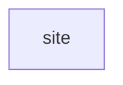

# Code wiki

Generated by `composer run build` from the module manifests, `build/surface.json` and the code index; an edit here fails gate:24. How AIC works: [the architecture pages](../../vendor/aic/framework/docs/README.md).

## Modules

| Module | Namespace | Requires | Required by | Routes | Classes |
| --- | --- | --- | --- | --- | --- |
| [site](modules/site.md) | `App\Site\` | none | none | Api 1, Page 1, Stream 2 | 10 |

## Requires

## Routes by kind

| Kind | Routes |
| --- | --- |
| Api | 1 |
| Page | 1 |
| Stream | 2 |

| Method | Path | Kind | Module | Handler |
| --- | --- | --- | --- | --- |
| GET | `/assets/{file}` | Stream | [site](modules/site.md) | `App\Site\Controller\AssetFile` |
| GET | `/assets/{dir}/{file}` | Stream | [site](modules/site.md) | `App\Site\Controller\AssetFile` |
| GET | `/health` | Api | [site](modules/site.md) | `App\Site\Controller\HealthApi` |
| GET | `/` | Page | [site](modules/site.md) | `App\Site\Controller\BootstrapPage` |

## Commands

| Name | Module | Class |
| --- | --- | --- |
| `db:ping` | site | `App\Site\Command\DatabasePing` |
| `migrate` | framework | `AIC\Schema\Application\MigrateCommand` |
| `migrate:status` | framework | `AIC\Schema\Application\MigrationStatusCommand` |
| `queue:work` | framework | `AIC\Queue\Application\QueueWorkCommand` |
| `schedule:run` | framework | `AIC\Schedule\Application\ScheduleRunCommand` |

## Jobs

| Name | Module | Class |
| --- | --- | --- |
| `notify` | framework | `AIC\Notification\Application\DeliverNotification` |

## Schedules

none
