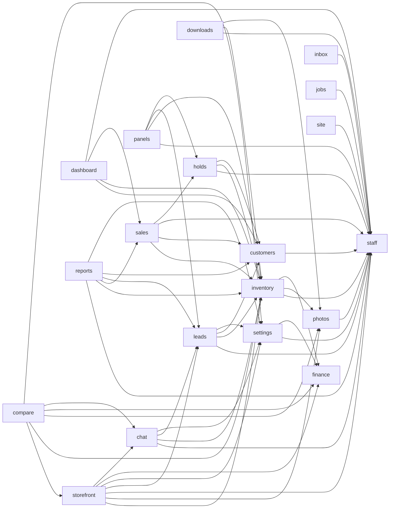

# Code wiki

Generated by `composer run build` from the module manifests, `build/surface.json` and the code index; an edit here fails gate:24. How AIC works: [the architecture pages](../../vendor/aic/framework/docs/README.md).

## Modules

| Module | Namespace | Requires | Required by | Routes | Classes |
| --- | --- | --- | --- | --- | --- |
| [staff](modules/staff.md) | `App\Staff\` | none | photos, inventory, customers, settings, leads, chat, storefront, holds, sales, dashboard, downloads, inbox, jobs, panels, reports, site | Page 3 | 30 |
| [photos](modules/photos.md) | `App\Photos\` | staff | inventory, storefront, compare, downloads | none | 12 |
| [finance](modules/finance.md) | `App\Finance\` | none | inventory, settings, storefront, compare | none | 4 |
| [inventory](modules/inventory.md) | `App\Inventory\` | staff, photos, finance | leads, chat, storefront, compare, holds, sales, dashboard, downloads, panels, reports | Page 14, Stream 1 | 74 |
| [customers](modules/customers.md) | `App\Customers\` | staff | leads, holds, sales, dashboard, reports | Page 11 | 43 |
| [settings](modules/settings.md) | `App\Settings\` | staff, finance | leads, chat, storefront, compare, reports | Page 9 | 47 |
| [leads](modules/leads.md) | `App\Leads\` | staff, inventory, customers, settings | chat, storefront, panels, reports | Page 6, Stream 1 | 56 |
| [chat](modules/chat.md) | `App\Chat\` | staff, inventory, leads, settings | storefront, compare | Page 7, Stream 2 | 43 |
| [storefront](modules/storefront.md) | `App\Storefront\` | inventory, photos, staff, leads, settings, finance, chat | compare | Api 2, Page 8, Stream 1 | 29 |
| [compare](modules/compare.md) | `App\Compare\` | storefront, inventory, photos, finance, chat, settings | none | Page 1 | 5 |
| [holds](modules/holds.md) | `App\Holds\` | staff, inventory, customers | sales, panels | Page 3 | 27 |
| [sales](modules/sales.md) | `App\Sales\` | inventory, customers, staff, holds | dashboard, reports | Page 6 | 43 |
| [dashboard](modules/dashboard.md) | `App\Dashboard\` | customers, inventory, sales, staff | none | Page 1 | 14 |
| [downloads](modules/downloads.md) | `App\Downloads\` | staff, inventory, photos | none | Stream 1 | 2 |
| [inbox](modules/inbox.md) | `App\Inbox\` | staff | none | Page 3, Stream 1 | 17 |
| [jobs](modules/jobs.md) | `App\Jobs\` | staff | none | Page 3 | 12 |
| [panels](modules/panels.md) | `App\Panels\` | staff, inventory, leads, holds | none | Page 3 | 13 |
| [reports](modules/reports.md) | `App\Reports\` | staff, inventory, sales, leads, customers, settings | none | Api 1, Page 2, Stream 1 | 49 |
| [site](modules/site.md) | `App\Site\` | staff | none | Api 1, Page 13 | 34 |

## Theme

Every component, layout and asset lives in `themes/lotline/` (#153). The page `themes/lotline/layouts/page.phtml` reads `App\Theme\Layouts\Page`, whose regions are sidebar, header, content, footer; the document is `themes/lotline/layouts/html.phtml`.

| Component | Template |
| --- | --- |
| `App\Theme\Components\BarChart\BarChart` | `themes/lotline/components/BarChart/bar-chart.phtml` |
| `App\Theme\Components\Bell\Bell` | `themes/lotline/components/Bell/bell.phtml` |
| `App\Theme\Components\BellBadge\BellBadge` | `themes/lotline/components/BellBadge/bell-badge.phtml` |
| `App\Theme\Components\BellCount\BellCount` | `themes/lotline/components/BellCount/bell-count.phtml` |
| `App\Theme\Components\BellItem\BellItem` | `themes/lotline/components/BellItem/bell-item.phtml` |
| `App\Theme\Components\BellItems\BellItems` | `themes/lotline/components/BellItems/bell-items.phtml` |
| `App\Theme\Components\BoardColumn\BoardColumn` | `themes/lotline/components/BoardColumn/board-column.phtml` |
| `App\Theme\Components\BoardStack\BoardStack` | `themes/lotline/components/BoardStack/board-stack.phtml` |
| `App\Theme\Components\BootstrapIntro\BootstrapIntro` | `themes/lotline/components/BootstrapIntro/bootstrap-intro.phtml` |
| `App\Theme\Components\BulkBar\BulkBar` | `themes/lotline/components/BulkBar/bulk-bar.phtml` |
| `App\Theme\Components\CarGrid\CarGrid` | `themes/lotline/components/CarGrid/car-grid.phtml` |
| `App\Theme\Components\CarProfile\CarProfile` | `themes/lotline/components/CarProfile/car-profile.phtml` |
| `App\Theme\Components\CardMove\CardMove` | `themes/lotline/components/CardMove/card-move.phtml` |
| `App\Theme\Components\CaseWatch\CaseWatch` | `themes/lotline/components/CaseWatch/case-watch.phtml` |
| `App\Theme\Components\ChatConversation\ChatConversation` | `themes/lotline/components/ChatConversation/chat-conversation.phtml` |
| `App\Theme\Components\ChatDock\ChatDock` | `themes/lotline/components/ChatDock/chat-dock.phtml` |
| `App\Theme\Components\ChatLine\ChatLine` | `themes/lotline/components/ChatLine/chat-line.phtml` |
| `App\Theme\Components\ChatList\ChatList` | `themes/lotline/components/ChatList/chat-list.phtml` |
| `App\Theme\Components\ChatLog\ChatLog` | `themes/lotline/components/ChatLog/chat-log.phtml` |
| `App\Theme\Components\ChatSendForm\ChatSendForm` | `themes/lotline/components/ChatSendForm/chat-send-form.phtml` |
| `App\Theme\Components\ChatStart\ChatStart` | `themes/lotline/components/ChatStart/chat-start.phtml` |
| `App\Theme\Components\ChatThread\ChatThread` | `themes/lotline/components/ChatThread/chat-thread.phtml` |
| `App\Theme\Components\CheckGroup\CheckGroup` | `themes/lotline/components/CheckGroup/check-group.phtml` |
| `App\Theme\Components\ColumnChart\ColumnChart` | `themes/lotline/components/ColumnChart/column-chart.phtml` |
| `App\Theme\Components\CompareDock\CompareDock` | `themes/lotline/components/CompareDock/compare-dock.phtml` |
| `App\Theme\Components\CompareDrawer\CompareDrawer` | `themes/lotline/components/CompareDrawer/compare-drawer.phtml` |
| `App\Theme\Components\CompareTable\CompareTable` | `themes/lotline/components/CompareTable/compare-table.phtml` |
| `App\Theme\Components\ConfirmCard\ConfirmCard` | `themes/lotline/components/ConfirmCard/confirm-card.phtml` |
| `App\Theme\Components\DataTable\DataTable` | `themes/lotline/components/DataTable/data-table.phtml` |
| `App\Theme\Components\DetailCard\DetailCard` | `themes/lotline/components/DetailCard/detail-card.phtml` |
| `App\Theme\Components\DownloadLink\DownloadLink` | `themes/lotline/components/DownloadLink/download-link.phtml` |
| `App\Theme\Components\EditRow\EditRow` | `themes/lotline/components/EditRow/edit-row.phtml` |
| `App\Theme\Components\FeedStatus\FeedStatus` | `themes/lotline/components/FeedStatus/feed-status.phtml` |
| `App\Theme\Components\FilterBar\FilterBar` | `themes/lotline/components/FilterBar/filter-bar.phtml` |
| `App\Theme\Components\FinanceCalculator\FinanceCalculator` | `themes/lotline/components/FinanceCalculator/finance-calculator.phtml` |
| `App\Theme\Components\FormActions\FormActions` | `themes/lotline/components/FormActions/form-actions.phtml` |
| `App\Theme\Components\FormField\FormField` | `themes/lotline/components/FormField/form-field.phtml` |
| `App\Theme\Components\FormGrid\FormGrid` | `themes/lotline/components/FormGrid/form-grid.phtml` |
| `App\Theme\Components\FormValue\FormValue` | `themes/lotline/components/FormValue/form-value.phtml` |
| `App\Theme\Components\Icon\Icon` | `themes/lotline/components/Icon/icon.phtml` |

and 30 more: `bin/aic code:tree themes`

Named layouts: a Page passes a `ThemeLayoutName` case; a file a layout leaves out falls back to the theme's own (`bin/aic make:layout <name>`).

| Layout | Page | Document | Page data | Regions |
| --- | --- | --- | --- | --- |
| `store` | `themes/lotline/layouts/page--store.phtml` | `themes/lotline/layouts/html--store.phtml` | `App\Theme\Layouts\StorePage` | masthead, content, colophon |

## Requires

## Routes by kind

| Kind | Routes |
| --- | --- |
| Api | 4 |
| Page | 93 |
| Stream | 8 |

| Method | Path | Kind | Module | Handler |
| --- | --- | --- | --- | --- |
| GET | `/sign-in` | Page | [staff](modules/staff.md) | `App\Staff\Controller\SignInPage` |
| POST | `/sign-in` | Page | [staff](modules/staff.md) | `App\Staff\Controller\SignInPost` |
| POST | `/sign-out` | Page | [staff](modules/staff.md) | `App\Staff\Controller\SignOutPost` |
| GET | `/app/inventory/new` | Page | [inventory](modules/inventory.md) | `App\Inventory\Controller\VehicleNewPage` |
| POST | `/app/inventory` | Page | [inventory](modules/inventory.md) | `App\Inventory\Controller\VehicleCreatePost` |
| GET | `/app/inventory/{vin}` | Page | [inventory](modules/inventory.md) | `App\Inventory\Controller\VehiclePage` |
| GET | `/app/inventory/{vin}/edit` | Page | [inventory](modules/inventory.md) | `App\Inventory\Controller\VehicleEditPage` |
| POST | `/app/inventory/{vin}` | Page | [inventory](modules/inventory.md) | `App\Inventory\Controller\VehicleUpdatePost` |
| POST | `/app/inventory/{vin}/photos` | Page | [inventory](modules/inventory.md) | `App\Inventory\Controller\VehiclePhotoPost` |
| GET | `/app/inventory/{vin}/photos/{position:int}` | Stream | [inventory](modules/inventory.md) | `App\Inventory\Controller\VehiclePhotoStream` |
| POST | `/app/inventory/{vin}/photos/{position:int}/delete` | Page | [inventory](modules/inventory.md) | `App\Inventory\Controller\VehiclePhotoDeletePost` |
| GET | `/app/inventory/{vin}/delete` | Page | [inventory](modules/inventory.md) | `App\Inventory\Controller\VehicleDeletePage` |
| POST | `/app/inventory/{vin}/delete` | Page | [inventory](modules/inventory.md) | `App\Inventory\Controller\VehicleDeletePost` |
| GET | `/app/inventory` | Page | [inventory](modules/inventory.md) | `App\Inventory\Controller\InventoryListPage` |
| GET | `/app/inventory/{vin}/row` | Page | [inventory](modules/inventory.md) | `App\Inventory\Controller\VehicleRowPage` |
| GET | `/app/inventory/{vin}/row/edit` | Page | [inventory](modules/inventory.md) | `App\Inventory\Controller\VehicleRowEditPage` |
| PUT | `/app/inventory/{vin}/row` | Page | [inventory](modules/inventory.md) | `App\Inventory\Controller\VehicleRowPut` |
| POST | `/app/inventory/bulk` | Page | [inventory](modules/inventory.md) | `App\Inventory\Controller\VehicleBulkPost` |
| GET | `/app/customers/new` | Page | [customers](modules/customers.md) | `App\Customers\Controller\CustomerNewPage` |
| POST | `/app/customers` | Page | [customers](modules/customers.md) | `App\Customers\Controller\CustomerCreatePost` |
| GET | `/app/customers/{id:int}` | Page | [customers](modules/customers.md) | `App\Customers\Controller\CustomerPage` |
| GET | `/app/customers/{id:int}/edit` | Page | [customers](modules/customers.md) | `App\Customers\Controller\CustomerEditPage` |
| POST | `/app/customers/{id:int}` | Page | [customers](modules/customers.md) | `App\Customers\Controller\CustomerUpdatePost` |
| GET | `/app/customers/{id:int}/delete` | Page | [customers](modules/customers.md) | `App\Customers\Controller\CustomerDeletePage` |
| POST | `/app/customers/{id:int}/delete` | Page | [customers](modules/customers.md) | `App\Customers\Controller\CustomerDeletePost` |
| GET | `/app/customers` | Page | [customers](modules/customers.md) | `App\Customers\Controller\CustomerListPage` |
| GET | `/app/customers/{id:int}/row` | Page | [customers](modules/customers.md) | `App\Customers\Controller\CustomerRowPage` |
| GET | `/app/customers/{id:int}/row/edit` | Page | [customers](modules/customers.md) | `App\Customers\Controller\CustomerRowEditPage` |
| PUT | `/app/customers/{id:int}/row` | Page | [customers](modules/customers.md) | `App\Customers\Controller\CustomerRowPut` |
| GET | `/app/settings` | Page | [settings](modules/settings.md) | `App\Settings\Controller\SettingsPage` |
| POST | `/app/settings/profile` | Page | [settings](modules/settings.md) | `App\Settings\Controller\ProfilePost` |
| POST | `/app/settings/staff` | Page | [settings](modules/settings.md) | `App\Settings\Controller\MemberAddPost` |
| GET | `/app/settings/staff/{id:int}` | Page | [settings](modules/settings.md) | `App\Settings\Controller\MemberPage` |
| POST | `/app/settings/staff/{id:int}` | Page | [settings](modules/settings.md) | `App\Settings\Controller\MemberPost` |
| POST | `/app/settings/staff/{id:int}/active` | Page | [settings](modules/settings.md) | `App\Settings\Controller\MemberActivePost` |
| POST | `/app/settings/staff/{id:int}/link` | Page | [settings](modules/settings.md) | `App\Settings\Controller\MemberLinkPost` |
| GET | `/password/{link}` | Page | [settings](modules/settings.md) | `App\Settings\Controller\PasswordPage` |
| POST | `/password/{link}` | Page | [settings](modules/settings.md) | `App\Settings\Controller\PasswordPost` |
| GET | `/app/leads/{id:int}` | Page | [leads](modules/leads.md) | `App\Leads\Controller\LeadPage` |
| POST | `/app/leads/{id:int}/assign` | Page | [leads](modules/leads.md) | `App\Leads\Controller\LeadAssignPost` |

and 65 more: `bin/aic route:list`

## Commands

| Name | Module | Class |
| --- | --- | --- |
| `customers:seed` | customers | `App\Customers\Command\CustomersSeed` |
| `db:ping` | site | `App\Site\Command\DatabasePing` |
| `inbox:forget` | inbox | `App\Inbox\Command\InboxForget` |
| `inventory:seed` | inventory | `App\Inventory\Command\InventorySeed` |
| `migrate` | framework | `AIC\Schema\Application\MigrateCommand` |
| `migrate:status` | framework | `AIC\Schema\Application\MigrationStatusCommand` |
| `photos:move-files` | photos | `App\Photos\Command\PhotosMoveFiles` |
| `queue:failed` | framework | `AIC\Queue\Application\QueueFailedCommand` |
| `queue:retry` | framework | `AIC\Queue\Application\QueueRetryCommand` |
| `queue:work` | framework | `AIC\Queue\Application\QueueWorkCommand` |
| `reports:move-exports` | reports | `App\Reports\Command\ReportsMoveExports` |
| `sales:seed` | sales | `App\Sales\Command\SalesSeed` |
| `schedule:run` | framework | `AIC\Schedule\Application\ScheduleRunCommand` |
| `staff:seed` | staff | `App\Staff\Command\StaffSeed` |
| `user:add` | staff | `App\Staff\Command\UserAdd` |
| `user:remove` | staff | `App\Staff\Command\UserRemove` |

## Jobs

| Name | Module | Class |
| --- | --- | --- |
| `aged-stock` | reports | `App\Reports\Job\NotifyAgedStock` |
| `chat-transcript` | chat | `App\Chat\Job\SendChatTranscript` |
| `daily-digest` | reports | `App\Reports\Job\SendDailyDigest` |
| `lead-notices` | leads | `App\Leads\Job\SendLeadNotices` |
| `lead-won` | leads | `App\Leads\Job\SendLeadWon` |
| `notify` | framework | `AIC\Notification\Application\DeliverNotification` |
| `photo-bundle` | photos | `App\Photos\Job\WritePhotoBundle` |
| `prune-exports` | reports | `App\Reports\Job\PruneReportExports` |
| `release-holds` | holds | `App\Holds\Job\ReleaseHolds` |
| `report-export` | reports | `App\Reports\Job\WriteReportExport` |

## Schedules

| Name | Cadence | Job | Module |
| --- | --- | --- | --- |
| `release-holds` | `*/15 * * * *` | `release-holds` | holds |
| `aged-stock` | `0 7 * * *` | `aged-stock` | reports |
| `daily-digest` | `0 21 * * *` | `daily-digest` | reports |
| `prune-exports` | `15 4 * * *` | `prune-exports` | reports |
